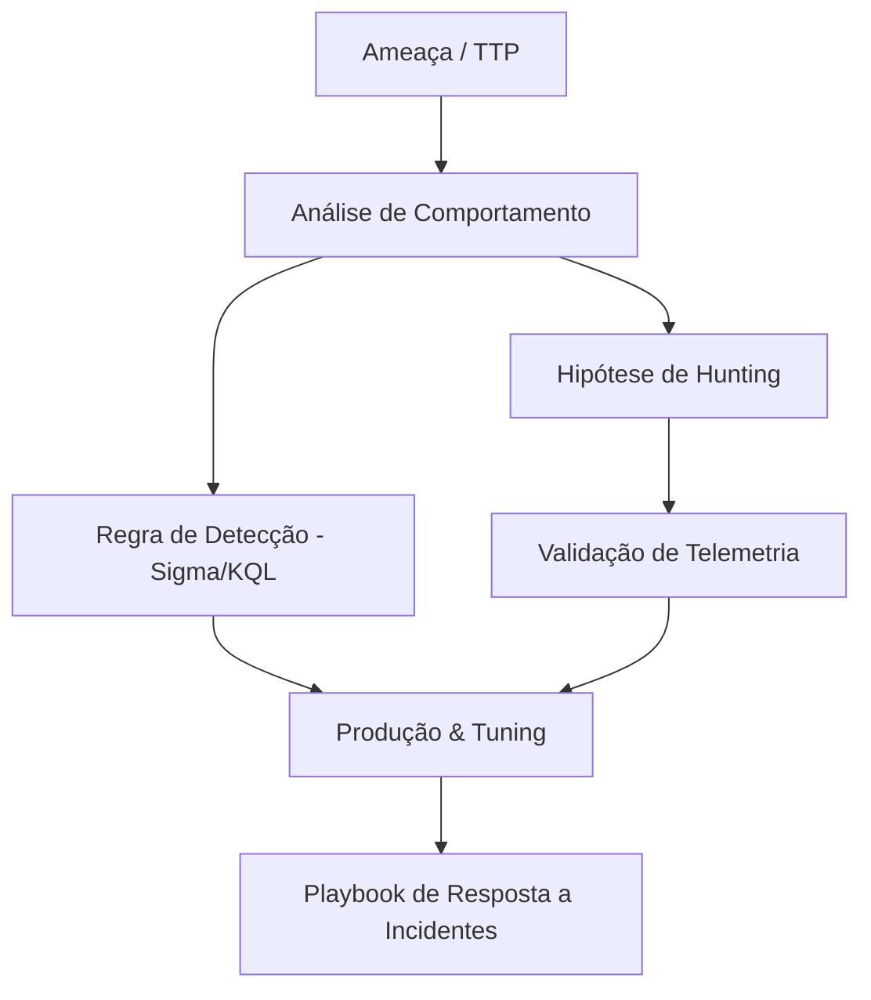

Seja bem-vindo ao **wh0r4c lab**! 

Este espaço é dedicado a registrar pesquisas, estudos de caso, análises de artefatos e metodologias práticas voltadas para **Detection Engineering**, **Threat Hunting** e **Incident Response (DFIR)**.

## Por que documentar?

No cenário moderno de cibersegurança defensiva, a simples coleta de logs não é suficiente. É fundamental entender:
1. **Mecanismos de Ataque:** Como os atacantes operam em baixo nível (API calls, injeção de processos, abuso de binários legítimos/LOLBins).
2. **Telemetria de Alta Fidelidade:** Quais fontes de dados (Sysmon, Windows Event Logs, EDR, Network Telemetry) capturam o comportamento malicioso com o menor índice de ruído.
3. **Detecção Resiliente:** Como construir regras (usando formatos abertos como **Sigma** ou linguagens como **KQL** e **SPL**) que resistam a variações simples de evasão.

## Áreas de Foco

### 1. Detection Engineering
- Engenharia de detecção com foco no framework **MITRE ATT&CK**.
- Criação e conversão de regras **Sigma** para múltiplos SIEMs.
- Validação contínua através de testes adversariais (Atomic Red Team, scripts customizados).

### 2. Threat Hunting
- Metodologia orientada a hipóteses.
- Caça a anomalias em telemetria bruta (queries em Microsoft Sentinel, Defender for Endpoint, Splunk).
- Identificação de persistência silenciosa e abuso de credenciais.

### 3. Incident Response & Forensics
- Triagem rápida de endpoints e análise de memória volátil.
- Interpretação de artefatos Windows (MFT, Shimcache, Amcache, Prefetch, Event Logs).

---

> Fique atento para os próximos posts, onde começaremos a analisar cenários práticos de ataque e construção de telemetria!
